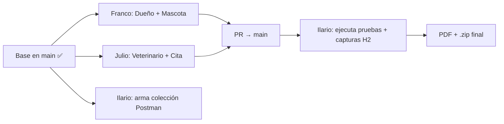

# Guía del equipo — Patitas del Santa

Cómo nos repartimos el trabajo y cómo usamos Git/GitHub.

---

## 1. Responsabilidades

### 🧑‍💻 Franco — Líder / integrador · rama `feature/dueno-mascota`
| Capa | Archivos |
|---|---|
| repository | `DuenoRepository` (`findByDni`), `MascotaRepository` (`findByDuenoDni`) |
| service | `DuenoService`, `MascotaService` |
| controller | `DuenoController`, `MascotaController` |

Reglas de negocio:
- El DNI del dueño no se repite → si ya existe, responder **409 / 400**.
- No se registra una mascota sin dueño → el service busca el dueño por `id`; si no existe, **404 / 400**.
- Al actualizar una mascota se puede cambiar su `peso` (se actualiza en cada visita).

Además: revisar y aprobar los Pull Requests, hacer merge a `main`, y es el único que modifica `pom.xml`, `application.properties` y `model/`.

### 🧑‍💻 Julio — Backend · rama `feature/veterinario-cita`
| Capa | Archivos |
|---|---|
| repository | `VeterinarioRepository` (`findByColegiatura`), `CitaRepository` (`findByVeterinarioIdAndEstado`) |
| service | `VeterinarioService`, `CitaService` |
| controller | `VeterinarioController`, `CitaController` |

Reglas de negocio (en `CitaService`):
- Toda cita **nace en `PROGRAMADA`** (ignorar el estado que venga en el JSON al crear).
- **Fecha no pasada:** `fechaHora` no puede ser anterior a `LocalDateTime.now()`.
- **Costo no negativo:** `costo >= 0`.
- La mascota y el veterinario deben existir (buscar por `id`).
- Colegiatura de veterinario no se repite.

Opcional (suma puntos): `controller/GlobalExceptionHandler` con `@RestControllerAdvice` para devolver errores en JSON limpio.

### 🧪 Ilario — Pruebas y documentación · rama `test/postman`
- Armar la colección de Postman con **todos** los endpoints (tabla de abajo).
- Datos mínimos: **3 dueños, 5 mascotas, 2 veterinarios, 4 citas**.
- Probar: crear, listar, buscar por id, actualizar, eliminar y las 2 búsquedas personalizadas.
- Probar los errores: costo negativo, fecha pasada, mascota sin dueño, DNI repetido.
- Consola H2 (`http://localhost:8080/h2-console`, JDBC URL `jdbc:h2:mem:patitasdb`, user `sa`) → capturas de `SELECT * FROM DUENOS;` `MASCOTAS;` `VETERINARIOS;` `CITAS;`
- Subir a la rama: `postman/patitas-del-santa.postman_collection.json` y `docs/capturas/`.
- Armar el **PDF final** de capturas.

> Ilario puede empezar **ya** a armar la colección con los JSON de ejemplo, sin esperar el código.

---

## 2. Contrato de endpoints (no cambiar sin avisar)

| Método | Ruta | Responsable |
|---|---|---|
| GET / POST | `/api/duenos` | Franco |
| GET / PUT / DELETE | `/api/duenos/{id}` | Franco |
| GET / POST | `/api/mascotas` | Franco |
| GET / PUT / DELETE | `/api/mascotas/{id}` | Franco |
| GET | `/api/mascotas/dueno/{dni}` | Franco |
| GET / POST | `/api/veterinarios` | Julio |
| GET / PUT / DELETE | `/api/veterinarios/{id}` | Julio |
| GET / POST | `/api/citas` | Julio |
| GET / PUT / DELETE | `/api/citas/{id}` | Julio |
| GET | `/api/citas/veterinario/{id}/programadas` | Julio |

Códigos de respuesta: `200` OK · `201` creado · `204` eliminado · `400` dato inválido · `404` no existe.

### JSON de ejemplo
```json
// POST /api/duenos
{ "dni": "45678912", "nombres": "Carmen", "apellidos": "Ríos Paredes",
  "celular": "987654321", "correo": "carmen@mail.com", "direccion": "Av. Pacífico 123, Nuevo Chimbote" }

// POST /api/mascotas
{ "nombre": "Firulais", "especie": "PERRO", "raza": "Mestizo", "sexo": "MACHO",
  "fechaNacimiento": "2021-05-10", "peso": 12.5, "dueno": { "id": 1 } }

// POST /api/veterinarios
{ "colegiatura": "CMVP-1234", "nombres": "Rosa", "apellidos": "Medina",
  "especialidad": "Medicina general", "activo": true }

// POST /api/citas
{ "fechaHora": "2026-12-01T10:30:00", "motivo": "Vacunación",
  "mascota": { "id": 1 }, "veterinario": { "id": 1 } }

// PUT /api/citas/1  (atender la cita)
{ "fechaHora": "2026-12-01T10:30:00", "motivo": "Vacunación", "estado": "ATENDIDA",
  "diagnostico": "Sano, vacuna aplicada", "costo": 50.00,
  "mascota": { "id": 1 }, "veterinario": { "id": 1 } }
```
Valores de enums: `especie` = PERRO, GATO, CONEJO, AVE, OTRO · `sexo` = MACHO, HEMBRA · `estado` = PROGRAMADA, ATENDIDA, CANCELADA.

---

## 3. Cómo trabajar con Git

### Resumen paso a paso

**Paso 1:** Franco crea el repo y sube la estructura base a `main` ✅ (ya hecho).

**Paso 2: cada uno trabaja en su rama**
```bash
git clone https://github.com/EnryuuLook51/patitas-del-santa.git
cd patitas-del-santa
git checkout feature/dueno-mascota       # Franco
git checkout feature/veterinario-cita    # Julio
git checkout test/postman                # Ilario
```
> Las ramas **ya existen en GitHub**, por eso se usa `git checkout <rama>` **sin** `-b`.
> (`-b` crea una rama nueva; solo úsalo si necesitas una rama adicional, ej. `git checkout -b fix/validacion-cita`).

**Paso 3: trabajar y subir cambios**
```bash
git add .
git commit -m "Agrega CRUD de Veterinario"
git push -u origin feature/veterinario-cita
```

**Paso 4: Pull Request.** En GitHub abren **Compare & pull request** hacia `main`, otro compañero lo revisa y se hace merge.

**Paso 5: actualizarse cuando otro hizo merge**
```bash
git checkout main
git pull
git checkout feature/mi-rama
git merge main      # resuelven conflictos si los hay
```

### Primera vez
```bash
git clone https://github.com/EnryuuLook51/patitas-del-santa.git
cd patitas-del-santa
git checkout feature/veterinario-cita     # Julio
git checkout test/postman                 # Ilario
git checkout feature/dueno-mascota        # Franco
```
Abrir el proyecto en IntelliJ / VS Code como proyecto **Maven**. Ejecutar con `mvn spring-boot:run` o con el botón ▶ de `PatitasDelSantaApplication`.

### Día a día
```bash
# 1. Antes de empezar: traer lo último de main a tu rama
git checkout main
git pull
git checkout <tu-rama>
git merge main

# 2. Trabajar y guardar cambios (commits pequeños)
git add .
git commit -m "Agrega CitaService con validación de costo y fecha"

# 3. Subir
git push
```

### Cuando terminas una parte → Pull Request
1. En GitHub: **Pull requests → New pull request**.
2. `base: main` ← `compare: <tu-rama>`.
3. Título claro (ej. *"CRUD de Veterinario y Cita"*) y describe qué probaste.
4. Franco revisa y hace merge. Si hay comentarios, corriges en tu misma rama y haces `push` (el PR se actualiza solo).

### Si hay conflicto al hacer `git merge main`
1. Abre los archivos marcados, busca `<<<<<<<` / `=======` / `>>>>>>>`.
2. Deja el código correcto y borra las marcas.
3. `git add .` → `git commit` → `git push`.
4. Si no sabes cuál dejar, **pregunta en el grupo antes de borrar código ajeno**.

---

## 4. Reglas del equipo

### Reglas para evitar conflictos
1. Las entidades del `model` las sube Franco primero. Si alguien necesita cambiar una, lo avisa en el grupo.
2. Cada uno toca solo sus archivos. `application.properties` y `pom.xml` son solo de Franco.
3. Commits pequeños y frecuentes, con mensajes claros.
4. Nadie hace `git push --force` a `main`.
5. El `.gitignore` ya ignora `target/`, `.idea/` y `*.iml`; no lo borren ni suban esas carpetas.

### Reglas generales
1. ❌ Nadie hace `push` directo a `main`. Todo entra por Pull Request.
2. ❌ Nada de `git push --force`.
3. ✏️ Solo tocas **tus** archivos. Cambios en `model/`, `pom.xml` o `application.properties` → avisar a Franco.
4. ✅ Antes de hacer push, el proyecto debe **compilar y arrancar** (`mvn spring-boot:run`).
5. 💬 Mensajes de commit en español, en presente y claros: *"Agrega…", "Corrige…", "Actualiza…"*.
6. 📦 No subir `target/`, `.idea/` ni `.vscode/` (ya están en `.gitignore`).

---

## 5. Orden de trabajo



| Paso | Quién | Entregable |
|---|---|---|
| 1 | Franco | Estructura base en `main` ✅ |
| 2 | Franco y Julio (en paralelo) | PR con CRUD completo de sus entidades |
| 3 | Ilario (en paralelo) | Colección Postman lista |
| 4 | Franco | Merge de ambos PR a `main` |
| 5 | Ilario | Pruebas sobre `main`, capturas Postman + H2 |
| 6 | Ilario + Franco | PDF de capturas y `.zip` del proyecto |
