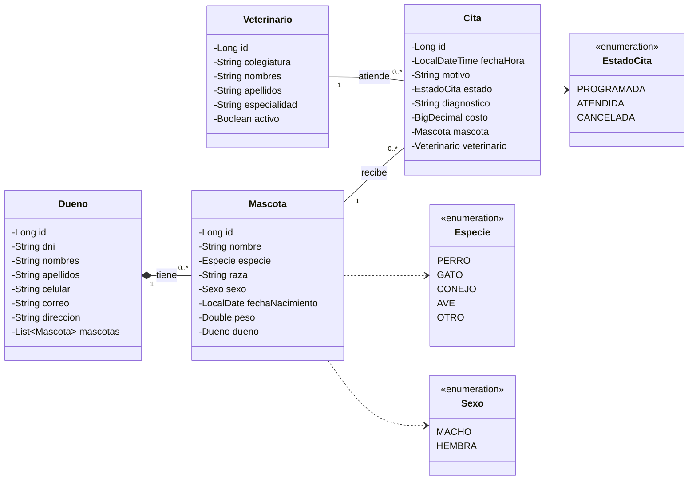
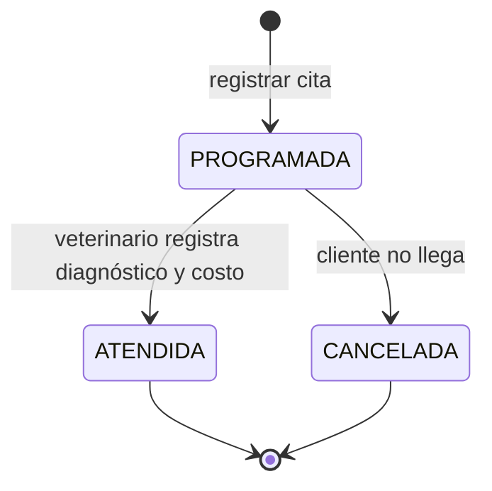
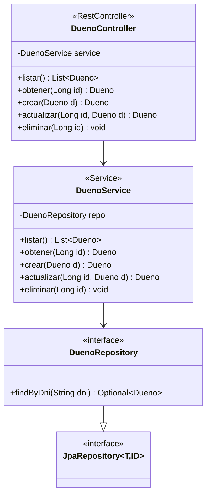

# Diagrama de Clases — Clínica Veterinaria "Patitas del Santa"

Spring Boot · JPA · H2 · Arquitectura de 3 capas

---

## 1. Modelo de dominio (paquete `model`)



### Relaciones y anotaciones JPA

| Relación | Multiplicidad | Lado dueño (FK) | Anotación |
|---|---|---|---|
| Dueno → Mascota | 1 a muchos (composición) | `mascota.dueno_id` | `@ManyToOne(optional = false)` en Mascota · `@OneToMany(mappedBy = "dueno")` en Dueno |
| Mascota → Cita | 1 a muchos | `cita.mascota_id` | `@ManyToOne(optional = false)` en Cita |
| Veterinario → Cita | 1 a muchos | `cita.veterinario_id` | `@ManyToOne(optional = false)` en Cita |

### Restricciones del caso

| Clase | Atributo | Regla | Dónde se valida |
|---|---|---|---|
| Dueno | `dni` | Único, obligatorio | `@Column(unique = true, nullable = false)` |
| Mascota | `dueno` | No existe mascota sin dueño | `@JoinColumn(nullable = false)` + service |
| Mascota | `especie`, `sexo` | Valores fijos | `@Enumerated(EnumType.STRING)` |
| Veterinario | `colegiatura` | Único, obligatorio | `@Column(unique = true, nullable = false)` |
| Cita | `estado` | Nace en `PROGRAMADA` | service (al crear) |
| Cita | `costo` | No negativo | service + `@PositiveOrZero` |
| Cita | `fechaHora` | No puede ser pasada | service + `@FutureOrPresent` |

> **Nota:** En `Dueno.mascotas` usar `@JsonIgnore` (o `@JsonManagedReference`/`@JsonBackReference`) para evitar recursión infinita al serializar a JSON.

---

## 2. Ciclo de vida de una Cita



---

## 3. Arquitectura de 3 capas (por entidad)

Se repite el mismo patrón para `Dueno`, `Mascota`, `Veterinario` y `Cita`.



### Consultas personalizadas (paquete `repository`)

| Repositorio | Método | Endpoint |
|---|---|---|
| `MascotaRepository` | `List<Mascota> findByDuenoDni(String dni)` | `GET /api/mascotas/dueno/{dni}` |
| `CitaRepository` | `List<Cita> findByVeterinarioIdAndEstado(Long id, EstadoCita estado)` | `GET /api/citas/veterinario/{id}/programadas` |
| `DuenoRepository` | `Optional<Dueno> findByDni(String dni)` | (uso interno / validación) |
| `VeterinarioRepository` | `Optional<Veterinario> findByColegiatura(String c)` | (uso interno / validación) |

---

## 4. Estructura de paquetes

```
src/main/java/pe/edu/uns/patitas/
├── model/        Dueno, Mascota, Veterinario, Cita, Especie, Sexo, EstadoCita
├── repository/   DuenoRepository, MascotaRepository, VeterinarioRepository, CitaRepository
├── service/      DuenoService, MascotaService, VeterinarioService, CitaService
└── controller/   DuenoController, MascotaController, VeterinarioController, CitaController
```

| Responsable | Clases |
|---|---|
| Franco | `model/*`, Dueno*, Mascota*, `application.properties` |
| Julio | Veterinario*, Cita* |
| Ilario | Colección Postman, capturas, PDF |
